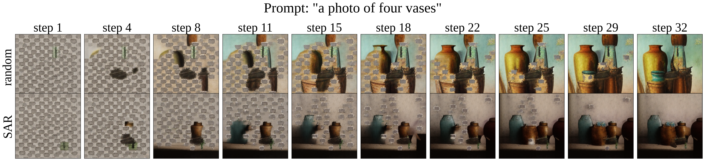
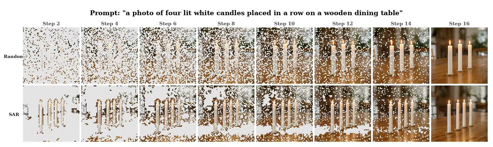
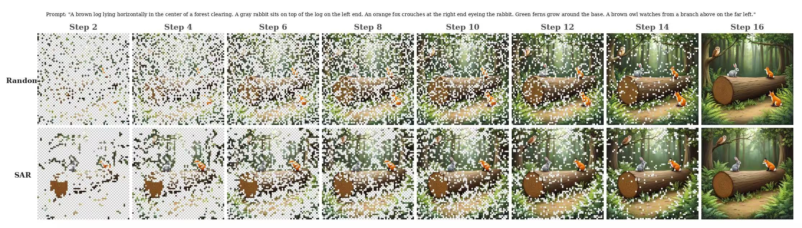

<div align="center">

# Saccades-AR
### Context-Aware Autoregressive Image Generation for Emerging Reasoning Properties

**NeurIPS 2026**

[Paper](https://arxiv.org/abs/2611.06838) · [PDF](https://arxiv.org/pdf/2611.06838) · [VAR guide](var/README.md) · [Infinity guide](infinity/README.md) · [Citation](#citation)

Jixuan Ying · Haoyu Liu · Timing Yang · Tingyu Zhu · Predrag Neskovic  
Anand Bhattad · Cihang Xie · Zeyu Zheng · Alan Yuille · Feng Wang

</div>

---

Official code for **Context-Aware Autoregressive Image Generation for Emerging Reasoning Properties**.

## Overview

Autoregressive image generation typically follows a predefined or heuristic generation order. **Saccade Autoregressive Generation (SAR)** instead determines which token positions to generate next from global conditioning and the current partially generated image.

At each step, SAR ranks the still-uncommitted positions by similarity to a conditioning anchor and commits the most context-relevant positions first. The ordering rule introduces no new learned parameters. The paper studies both **patch-wise models (MAR and MaskGen)** and **scale-wise models (VAR and Infinity)**.

Across ImageNet, GenEval, DPG-Bench, MJHQ-30K, and the paper's complex long-prompt benchmark, we evaluate generation quality, prompt alignment, and compositional reasoning. Qualitative trajectories illustrate two complementary behaviors: **outline-to-detail generation** in scale-wise models and **object-by-object generation** in patch-wise models.

## Generation trajectories

### Object-by-object generation · MaskGen-XL

[](assets/paper/order_illustrate.png)

For the prompt **“a photo of four vases,”** SAR progressively completes objects, while random ordering develops scattered parts concurrently. Columns show successive autoregressive steps; Random is the top row and SAR the bottom row.

### Outline-to-detail generation · Infinity-8B

[](assets/paper/candle.jpg)

For **four lit white candles in a row**, SAR establishes the object layout early and fills in details over subsequent last-scale decoding steps. The top row uses Random ordering; the bottom row uses SAR.

<details>
<summary><strong>More examples: objects and spatial relations</strong></summary>

[](assets/paper/fox.jpg)

A complex prompt specifies a rabbit on the left of a log, a fox on the right, and an owl above. This example illustrates the paper's outline-to-detail behavior under SAR. Random is shown above SAR.

</details>

*Figures are reproduced from the paper. Click an image to view it at full size.*

## Selected results

GenEval overall pass rate (%, higher is better), as reported in the paper:

| Model | Random | SAR |
| :--- | ---: | ---: |
| MaskGen-L | 53.94 | **57.49** |
| MaskGen-XL | 56.22 | **59.99** |
| Infinity-2B | 71.79 ± 0.46 | **72.57 ± 0.65** |
| Infinity-8B | 80.63 ± 0.60 | **81.34 ± 0.81** |

See the [paper](https://arxiv.org/abs/2611.06838) for the full results, experimental settings, and ablations.

## Getting started

```bash
git clone https://github.com/Hpesojyjx/Saccades-AR.git
cd Saccades-AR
```

Run all commands from this directory. Use separate Python 3.10 environments for VAR and Infinity, download the required upstream weights, then follow the corresponding guide:

| Start here | What you need |
| :--- | :--- |
| [VAR training and inference](var/README.md) | VAR initialization, VAE, and ImageNet-1K for retraining |
| [Infinity text-to-image inference](infinity/README.md) | Infinity weights, BSQ-VAE, FLAN-T5-XL, and text prompts |

GPU execution requires a compatible NVIDIA CUDA environment. Infinity additionally requires a compatible FlashAttention build. Dependency pins are supplied in [requirements/](requirements/); installation and GPU runtime depend on your platform.

## Installation

VAR and Infinity require different PyTorch versions. Install them in separate Python 3.10 environments.

### VAR environment

```bash
conda create -n sar-var python=3.10
conda activate sar-var
pip install torch==2.1.0 torchvision==0.16.0 --index-url https://download.pytorch.org/whl/cu121
pip install -r requirements/var.txt
```

### Infinity environment

```bash
conda create -n sar-infinity python=3.10
conda activate sar-infinity
pip install -r requirements/infinity.txt
```

Infinity GPU inference also requires a `flash-attn` build compatible with the installed CUDA toolkit and PyTorch version.

## Required resources

### VAR

- [VAR-d16 checkpoint](https://huggingface.co/FoundationVision/var/resolve/main/var_d16.pth)
- [VAR-d20 checkpoint](https://huggingface.co/FoundationVision/var/resolve/main/var_d20.pth)
- [VAR VAE checkpoint](https://huggingface.co/FoundationVision/var/resolve/main/vae_ch160v4096z32.pth)
- ImageNet-1K arranged as a torchvision `ImageFolder`

### Infinity

- [Infinity-2B checkpoint](https://huggingface.co/FoundationVision/infinity/blob/main/infinity_2b_reg.pth)
- [Infinity-8B sharded checkpoint](https://huggingface.co/FoundationVision/Infinity/tree/main/infinity_8b_weights)
- [Infinity regularized BSQ-VAE](https://huggingface.co/FoundationVision/Infinity/blob/main/infinity_vae_d32reg.pth)
- [FLAN-T5-XL](https://huggingface.co/google/flan-t5-xl)
- A UTF-8 prompt file with one prompt per line

## Experiment commands

The seed `0` is an example, not a record of the paper's experimental seeds. Replace all `/path/to/...` values with local resources. Keep checkpoints, sampling settings, prompts, and step budgets matched when comparing Random with SAR.

<details>
<summary><strong>Show training, inference, and benchmark-generation commands</strong></summary>


### Train a four-step VAR checkpoint

```bash
for DEPTH in 16 20; do
  NPROC_PER_NODE=8 bash var/scripts/train.sh \
    --depth "${DEPTH}" \
    --data-root /path/to/imagenet \
    --pretrained "/path/to/var_d${DEPTH}.pth" \
    --vae-checkpoint /path/to/vae_ch160v4096z32.pth \
    --output-dir "./checkpoints/var_d${DEPTH}_sar" \
    --num-steps 4 \
    --bs 768 \
    --ep 250 \
    --seed 0
done
```

### Run VAR one-step, Random, and SAR inference

```bash
# One-step reference using the retrained checkpoint
bash var/scripts/infer.sh \
  --depth 16 \
  --order original \
  --checkpoint ./checkpoints/var_d16_sar/ar-ckpt-last.pth \
  --vae-checkpoint /path/to/vae_ch160v4096z32.pth \
  --labels 0,1,2 \
  --samples-per-label 4 \
  --seed 0 \
  --output-dir ./outputs/var_original

# Matched Random and SAR inference
for ORDER in random sar; do
  bash var/scripts/infer.sh \
    --depth 16 \
    --order "${ORDER}" \
    --num-steps 4 \
    --checkpoint ./checkpoints/var_d16_sar/ar-ckpt-last.pth \
    --vae-checkpoint /path/to/vae_ch160v4096z32.pth \
    --labels 0,1,2 \
    --samples-per-label 4 \
    --seed 0 \
    --output-dir "./outputs/var_${ORDER}"
done
```

### Run Infinity-2B Random and SAR inference

```bash
for ORDER in random sar; do
  bash infinity/scripts/infer.sh \
    --model 2b \
    --order "${ORDER}" \
    --num-steps 16 \
    --model-path /path/to/infinity_2b_reg.pth \
    --vae-path /path/to/infinity_vae_d32reg.pth \
    --text-encoder /path/to/flan-t5-xl \
    --prompts examples/prompts.txt \
    --seed 0 \
    --output-dir "./outputs/infinity_2b_${ORDER}"
done
```

### Run Infinity-8B Random and SAR inference

```bash
for ORDER in random sar; do
  bash infinity/scripts/infer.sh \
    --model 8b \
    --order "${ORDER}" \
    --num-steps 16 \
    --model-path /path/to/infinity_8b_weights \
    --vae-path /path/to/infinity_vae_d32reg.pth \
    --text-encoder /path/to/flan-t5-xl \
    --prompts examples/prompts.txt \
    --seed 0 \
    --output-dir "./outputs/infinity_8b_${ORDER}"
done
```

### Run the Infinity-8B deterministic-order ablation

```bash
for ORDER in sequential inside_out; do
  bash infinity/scripts/infer.sh \
    --model 8b \
    --order "${ORDER}" \
    --num-steps 16 \
    --cfg 3.0 \
    --tau 1.0 \
    --model-path /path/to/infinity_8b_weights \
    --vae-path /path/to/infinity_vae_d32reg.pth \
    --text-encoder /path/to/flan-t5-xl \
    --prompts /path/to/benchmark_prompts.txt \
    --samples-per-prompt 4 \
    --seed 0 \
    --output-dir "./outputs/infinity_8b_${ORDER}"
done
```

### Generate GenEval images

Prepare the Infinity-rewritten GenEval prompts as a UTF-8 file with one prompt per line, preserving evaluator order.

```bash
for ORDER in random sequential inside_out sar; do
  bash infinity/scripts/infer.sh \
    --model 8b \
    --order "${ORDER}" \
    --num-steps 16 \
    --model-path /path/to/infinity_8b_weights \
    --vae-path /path/to/infinity_vae_d32reg.pth \
    --text-encoder /path/to/flan-t5-xl \
    --prompts /path/to/geneval_prompts.txt \
    --samples-per-prompt 4 \
    --seed 0 \
    --output-dir "./outputs/geneval_infinity_8b_${ORDER}"
done
```

### Generate DPG-Bench images and 2x2 grids

```bash
for ORDER in random sequential inside_out sar; do
  bash infinity/scripts/infer.sh \
    --model 8b \
    --order "${ORDER}" \
    --num-steps 16 \
    --model-path /path/to/infinity_8b_weights \
    --vae-path /path/to/infinity_vae_d32reg.pth \
    --text-encoder /path/to/flan-t5-xl \
    --prompts /path/to/dpg_bench_prompts.txt \
    --samples-per-prompt 4 \
    --seed 0 \
    --output-dir "./outputs/dpg_infinity_8b_${ORDER}"

  python infinity/evaluation/make_2x2_grids.py \
    --input-dir "./outputs/dpg_infinity_8b_${ORDER}" \
    --output-dir "./outputs/dpg_infinity_8b_${ORDER}_grids"
done
```

Use the official GenEval and DPG-Bench evaluators to score the generated images.

### Generate MJHQ-30K images and compute FID

```bash
bash infinity/scripts/infer.sh \
  --model 8b \
  --order sar \
  --num-steps 16 \
  --cfg 3.0 \
  --tau 1.0 \
  --model-path /path/to/infinity_8b_weights \
  --vae-path /path/to/infinity_vae_d32reg.pth \
  --text-encoder /path/to/flan-t5-xl \
  --prompts /path/to/mjhq30k_prompts.txt \
  --samples-per-prompt 1 \
  --seed 0 \
  --output-dir ./outputs/mjhq30k_infinity_8b_sar

pip install -r requirements/evaluation.txt
python -m pytorch_fid \
  ./outputs/mjhq30k_infinity_8b_sar \
  /path/to/mjhq30k/reference/images \
  --device cuda:0
```

### Compute ImageNet FID for VAR

```bash
pip install -r requirements/evaluation.txt
python -m pytorch_fid \
  /path/to/generated/images \
  /path/to/pytorch_fid_compatible_imagenet256_stats.npz \
  --device cuda:0
```

See the [VAR guide](var/README.md) and [Infinity guide](infinity/README.md) for full-dataset generation, output naming, distributed execution, and benchmark-specific commands.


The FID statistics must be compatible with the selected evaluator and its preprocessing. The `pytorch_fid` commands alone do not reproduce ADM Inception Score, precision, or recall. Benchmark prompt preparation and evaluator-specific output conversion remain separate steps.

</details>

## Repository layout

```text
Saccades-AR/
├── var/                       # Multi-step training and class-conditional inference
├── infinity/                  # Text-to-image inference and image-grid utility
├── requirements/              # Model-specific and evaluation dependencies
├── examples/prompts.txt       # Example text prompts
├── LICENSE
└── THIRD_PARTY_NOTICES.md
```

## Citation

```bibtex
@inproceedings{ying2026contextaware,
  title     = {Context-Aware Autoregressive Image Generation for Emerging Reasoning Properties},
  author    = {Ying, Jixuan and Liu, Haoyu and Yang, Timing and Zhu, Tingyu and Neskovic, Predrag and Bhattad, Anand and Xie, Cihang and Zheng, Zeyu and Yuille, Alan and Wang, Feng},
  booktitle = {Advances in Neural Information Processing Systems},
  year      = {2026},
  url       = {https://arxiv.org/abs/2611.06838}
}
```

## Acknowledgments and license

Built on [VAR](https://github.com/FoundationVision/VAR) and [Infinity](https://github.com/FoundationVision/Infinity) by FoundationVision. We thank their authors for releasing the models and code.

See [LICENSE](LICENSE), [THIRD_PARTY_NOTICES.md](THIRD_PARTY_NOTICES.md), and the retained per-file notices for code licensing and attribution. Separately downloaded model weights, text encoders, and datasets retain their respective licenses.

## Questions and issues

For implementation questions or reproducibility issues, please [open an issue](https://github.com/Hpesojyjx/Saccades-AR/issues). Include the model, generation order, command, software environment, and error trace where relevant.
